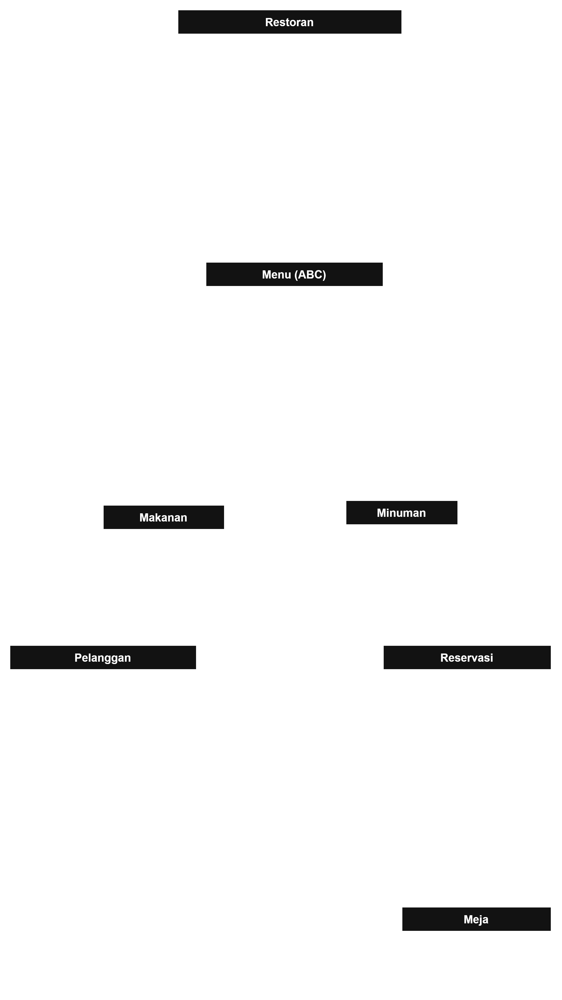
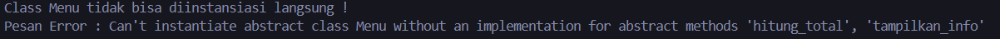
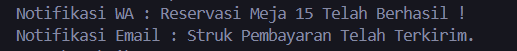
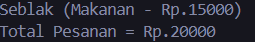

Sistem Manajemen Restoran dan Reservasi Meja

Konsep dari Sistem Manajemen Restoran dan Reservasi Meja dirancang untuk mensimulasikan operasional dasar dari sebuah Restoran berdasarkan program berbasis objek yang rapi dan terstruktur.

Penjelasan lebih lanjut terkait program ini adalah sebagai berikut :
1. 

- Asosiasi(Pelanggan -> Reservasi) : Relasi interaksi antara objek Pelanggan dengan Reservasi melalui method buat_reservasi(reservasi). Multiplistas 1 ke 1 yang berarti satu pelanggan melakukan satu reservasi.

Berikut method yang digunakan : 

def buat_reservasi(self, reservasi):
        print("======= DETAIL RESERVASI ========")
        print(f"Nama       : {self.nama}")
        print(f"No.Hp      : {self.no_hp}")
        print(f"Nomor Meja : {reservasi.detail_meja.nomor_meja}")
        print(f"Kapasitas : {reservasi.detail_meja.kapasitas} orang")

- Agregasi(Restoran -> Menu) : Relasi "memiliki" yang bersifat lemah. Kelas Restoran menampung daftar objek Menu pada atribut self.daftar_menu. Multiplistas 1 ke * artinya satu restoran dapat memiliki banyak menu. Alasan Agregasi karena objek Menu berdiri secara independen dan tetap ada walaupun objek Restoran dihapus.

- Komposisi(Reservasi -> Meja) : Relasi "terdiri dari" yang bersifat kuat. Objek Meja dibuat langsung di dalam konstruktor __init__ yang menandakan satu transaksi reservasi terikat pada tepat satu objek meja.

2. Abstraksi : Terdapat pada kelas Menu(ABC). 

Berikut Method yang digunakan pada kelas Menu :
@abstractmethod
def tampilkan_info(self):
    pass

@abstractmethod
def hitung_total(self, jumlah):
    pass 

Kedua method diatas akan digunakan di subclass Makanan dan Minuman.

Berikut Method yang digunakan pada kelas Makanan :
def tampilkan_info(self):
    print(f"Menu : {self.nama_menu} | Kategori : {self.kategori_menu} | Harga : {self._harga_menu} | Tingkat Kepedasan : {self.tingkat_pedas}")

def hitung_total(self, jumlah):
    return self._harga_menu * jumlah

Berikut Method yang digunakan pada kelas Minuman :
def tampilkan_info(self):
    print(f"Menu : {self.nama_menu} | Kategori : {self.kategori_menu} | Harga : {self._harga_menu} | Ukuran : {self.ukuran_gelas}")

def hitung_total(self, jumlah):
    return self._harga_menu * jumlah

Berikut Method yang digunakan untuk uji coba :
try : 
    tes_menu = Menu("Bakso", "Makanan", 15000 )

except TypeError as err :
    print("Class Menu tidak bisa diinstansiasi langsung !")
    print(f"Pesan Error : {err}\n")

Output : 

3. Polimorfisme dan Pewarisan : Terdapat pada Method tampilkan_semua_menu() pada kelas Restoran.

4. Duck Typing : Method kirim_notifikasi(layanan, pesan) yang menerima objek dari NotifikasiWhatsapp atau NotifikasiEmail.

Berikut kode yang digunakan : 
class NotifikasiWhatsapp:
    def kirim(self, pesan):
        print(f"Notifikasi WA : {pesan}")

class NotifikasiEmail:
    def kirim(self, pesan):
        print(f"Notifikasi Email : {pesan}")

def kirim_notifikasi(layanan, pesan):
    layanan.kirim(pesan)

Berikut uji coba : 
wa = NotifikasiWhatsapp()
email = NotifikasiEmail()

kirim_notifikasi(wa, "Reservasi Meja 15 Telah Berhasil !")
kirim_notifikasi(email, "Struk Pembayaran Telah Terkirim.")

Berikut output :

5. Overloading : __str__ untuk mengubah format cetak objek Menu menjadi string dan __add__ yang memungkinkan melakukan penjumlahan langsung.

Berikut Method yang digunakan : 
def __str__(self):
    return f"{self.nama_menu} ({self.kategori_menu} - Rp.{self._harga_menu})"

def __add__(self, other):
    if isinstance(other, Menu):
        return self._harga_menu + other._harga_menu
    return NotImplemented

Berikut uji coba : 
es_teh = Minuman("Es Teh", "Minuman", 5000, "Large")
seblak = Makanan("Seblak", "Makanan", 15000, 5)

print(seblak) # __str__
total = seblak + es_teh # __add__
print(f"Total Pesanan = Rp.{total}")

Berikut output : 

6. SOLID : Prinsip yang digunakan ada 2 yaitu SRP dan OCP.
- Single Responsibility Principle (SRP) : Logika pengiriman notifikasi dipisahkan dengan kelas terpisah tanpa mengganggu kelas Reservasi dan Pelanggan yang berfokus pada transaksi reservasi.

- Open Closed Principle (OCP) : Pada kelas Menu (ABC) terbuka untuk ditambahkan fitur baru lagi.